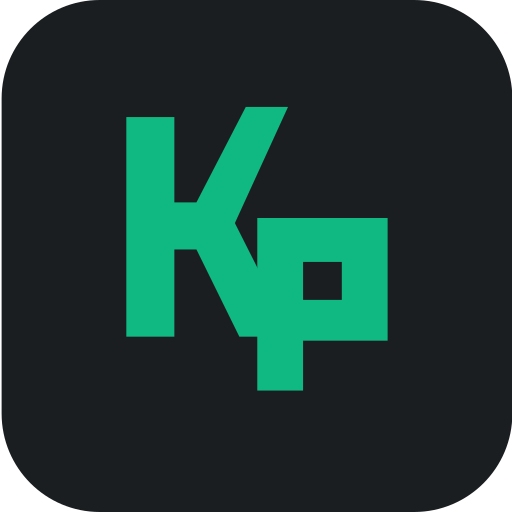

# Klyp

<div align="center">



**Modern Web Video Downloader, Queue Manager & Subtitles Explorer**

[](https://react.dev/)
[](https://www.typescriptlang.org/)
[](https://vitejs.dev/)
[](https://tailwindcss.com/)
[](https://github.com/yt-dlp/yt-dlp)

</div>

---

## Overview

**Klyp** is a modern, high-performance web application rewritten in React, TypeScript, and Vite. Designed to manage media downloads across dozens of platforms (YouTube, Vimeo, SoundCloud, Bilibili, TikTok, Twitch, and more), Klyp provides queue management, format quality control, subtitle downloads via OpenSubtitles, batch stream comparison, and download history tracking.

---

## Key Features

### 1. Multi-Platform Video & Audio Ingestion
- Extract stream information, resolutions, formats, and channels for YouTube, Vimeo, SoundCloud, Bilibili, TikTok, and more.
- Playlist and series detection with batch queuing.
- Full resolution selection: 4K (2160p), 1080p, 720p, 480p, 360p, and dedicated Audio Only extraction (MP3, AAC, FLAC, OPUS, WAV).

### 2. Search Explorer
- Integrated video and audio search with DuckDuckGo fallback.
- Domain and platform filtering: All, Video Streaming, Anime, Music, Social Media, Gaming, Podcasts.
- Content Presets: Anime, Music, Gaming, Podcasts, Social, Education.
- Side-by-side Batch Comparison dialog to inspect and compare video streams before downloading.
- Built-in preview player.

### 3. Queue Management
- Manage sequential or parallel downloads (up to 3 concurrent threads).
- Real-time download progress tracking with speed (MB/s), estimated time remaining (ETA), and percentages.
- Import and export queue structures as JSON.
- Pause, resume, and cancel individual downloads or batch operations.

### 4. Subtitles Explorer
- OpenSubtitles integration with multi-language lookup (English, Spanish, French, German, Italian, Portuguese, Russian, Japanese, Chinese, Korean, Arabic, Hindi).
- Drag-and-drop video file matching.
- Live subtitle preview and direct .SRT file export.

### 5. Download History & Playback
- Complete history library of past downloads with file sizes, completion dates, and formats.
- Built-in media player to watch or listen to media files directly in the browser.
- One-click file export and queue re-adding.

### 6. Full Customization & Preferences
- Signature Klyp Emerald Green color scheme with Dark and Light mode toggles.
- SponsorBlock integration preference.
- Metadata and thumbnail embedding options.
- Proxy routing configuration (HTTP, HTTPS, SOCKS5).

---

## Getting Started

### Development
```bash
npm install
npm run dev
```

### Build & Production
```bash
npm run build
npm start
```
